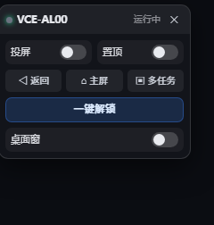

# dsh-dfy-mirror

[](LICENSE)
[](https://github.com/xiaozqi/dsh-dfy-mirror/actions/workflows/ci.yml)

Android screen mirroring for [DeepSeek Harness](https://github.com/deepseek-ai):
click the capsule in the DSH header and a **native scrcpy window** appears (optionally
always-on-top). One process, one state machine — if the process is gone, the UI says so.

> **Windows only.** macOS/Linux are not supported: the host shells out to `taskkill`,
> `winget`, `%LOCALAPPDATA%` and `PATHEXT`. See *Known limitations*.
>
> 中文说明 → [README.md](README.md)



## What it does

| Part | Implementation |
| --- | --- |
| Picture | scrcpy's own window (`--always-on-top` optional) |
| Control | DSH panel buttons → `adb shell input ...`; the scrcpy window itself is also clickable |
| State | `idle → starting → running → stopping → idle`, failures land in `error` |
| Failure | process exit is the only truth — no "process died but UI still says running" |

Deliberately not done: embedding a video stream in the panel (proxy + ffmpeg + MJPEG),
and a second desktop control window. Both are documented in [LESSONS.md](LESSONS.md).

## Requirements

- Windows 10 / 11
- [adb](https://developer.android.com/tools/releases/platform-tools) (platform-tools)
- [scrcpy](https://github.com/Genymobile/scrcpy) 2.x / 5.x

Both can be installed from the panel with one click (winget) — no manual setup needed.

## Install

1. Copy this directory into `~/.dsh/plugins/`
2. Run `install-to-dsh.cmd` — it registers the dependency + bundle in your DSH profile
   (backing up `package.json` first) and links it into `node_modules`
3. Fully quit DSH (including the tray icon) and start it again

The capsule ("手机") appears at the top center of the DSH window.

## Configuration

`~/.dsh/dsh-dfy-mirror.json` — hot-reloaded on change, no restart needed.

| Key | Default | Meaning |
| --- | --- | --- |
| `serial` | `""` | `ip:5555` or a USB serial |
| `adb` / `scrcpy` | `""` | empty = auto-detect |
| `autoStart` | `false` | start mirroring when DSH starts |
| `alwaysOnTop` | `true` | keep the phone window on top |
| `windowWidth` | `460` | content width in physical pixels |
| `turnScreenOff` | `true` | turn the phone screen off while mirroring |
| `audio` | `false` | forward phone audio to the PC |
| `graceMs` | `1200` | how long scrcpy must survive to count as "started" |
| `reconnect` | `true` | retry on unexpected disconnects (6 attempts) |
| `pin` | `""` | lock-screen PIN, **stored in plain text**; used only for one-tap unlock |

## Unlock / lock

`POST /dsh-dfy-mirror/unlock` runs the whole wake → dismiss-keyguard → swipe → type-PIN
sequence as **one adb shell command**; all branches and sleeps happen on the phone.
Measured: 0.4 s when already unlocked, 4.7 s from screen-off + locked.

The keyguard check reads `dumpsys window` / `dumpsys power`. Signals known from Android 10
(`isStatusBarKeyguard`, `mDreamingLockscreen`) plus Android 12+ style
(`mKeyguardShowing`, `KeyguardServiceDelegate showing=`). If **no** signal is present the
plugin reports "cannot read lock state" and refuses to type anything — it never guesses.

## HTTP API

All routes live under `/dsh-dfy-mirror`. Mutating routes accept **POST only** and require
same-origin plus an `x-dpm-token` header (random per host start, embedded only in the
same-origin `/panel.js`).

| Method | Path | Purpose |
| --- | --- | --- |
| GET | `/status` | state machine + device info |
| GET | `/phone` | `{ok, locked, awake, supported}` |
| GET/POST | `/config` | read (PIN masked) / write |
| GET | `/devices` | `adb devices -l` |
| POST | `/start` `/stop` | start / stop the scrcpy window |
| POST | `/key` | `{code}` keyevent (4 back, 3 home, 187 recents) |
| POST | `/unlock` `/lock` | unlock / lock |
| POST | `/topmost` | `{on: true|false}` |
| GET | `/log` | last 120 log lines |

## Known limitations

- Windows only (see above).
- Numeric PIN only — pattern / password locks are not supported.
- Lock-state detection is verified on Android 10; Android 12+ patterns are covered by tests
  but not by a real device.
- One phone at a time. With several devices online the panel asks you to pick one.
- Audio is off by default.
- **Localhost only**: the plugin exposes phone control over local HTTP. Writing is guarded
  by origin + POST + token, but there is no account system — do not expose the DSH web port
  to a LAN you do not trust. See [SECURITY.md](SECURITY.md).
- Not implemented: screenshots, file transfer, clipboard sync, volume/power keys, rotation.

## Tests

```bash
npm test
```

35 unit/smoke tests, no phone and no scrcpy required. CI runs Ubuntu + Windows on Node 20/22.

## License

MIT
