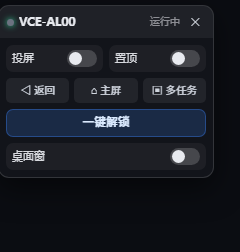
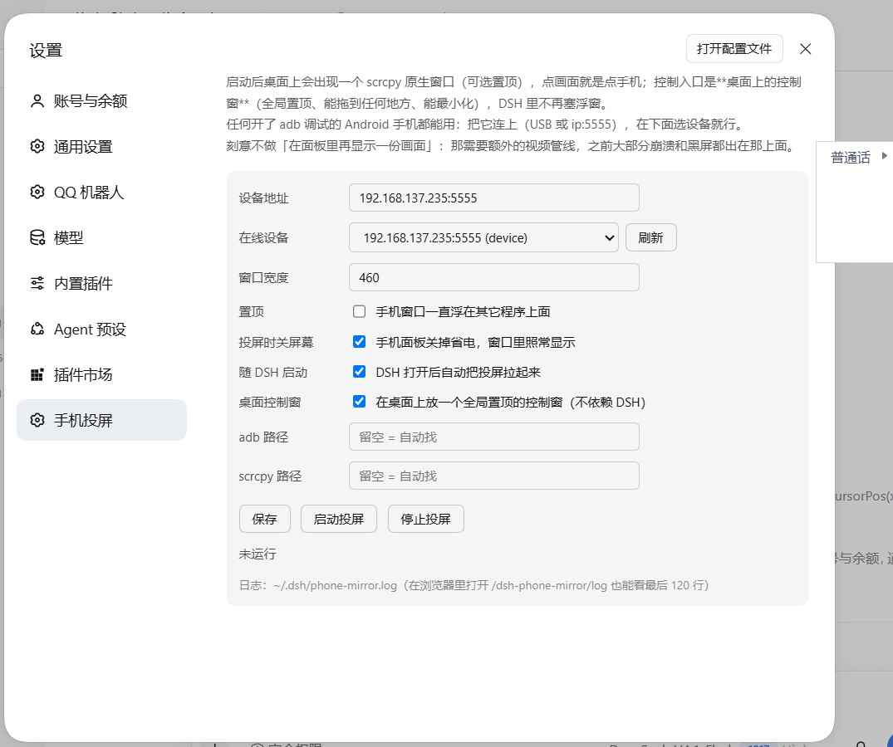

# dqy 青鱼手机镜像 · dsh-dqy-mirror

[](LICENSE)
[](https://github.com/xiaozqi/dsh-dqy-mirror/actions/workflows/ci.yml)

给 [DSH](https://github.com/deepseek-ai) 加一个「手机投屏」：点一下，桌面上出现一个 **scrcpy 原生窗口**（可选置顶）。

> **平台**：Windows 10 / 11。macOS / Linux 没有适配，原因是实现里用了 `taskkill`、`winget`、`PATHEXT` 这些 Windows 专有的东西（见「已知限制」）。
>
> English README → [README.en.md](README.en.md)

一个入口：

| 入口 | 位置 | 说明 |
| --- | --- | --- |
| **DSH 胶囊 / 面板** | 胶囊固定在 DSH 顶部正中 | 点胶囊展开：投屏 / 置顶 两个开关、返回/主屏/多任务、解锁/锁屏；面板每次打开都在**上方正中**，打开后可以拖走 |

> v4 删掉了「设置 → 手机投屏」那一页——配置项一共就几个，直接改
> `~/.dsh/dsh-dqy-mirror.json` 更省事，也不想在设置里塞一个半成品的控制面板。

- 快捷键：`Ctrl+Shift+M` 开合面板（DSH 窗口有焦点时）
- 标题上的型号在第一次查询状态时就取回来了，不用先点投屏
- 手机断开时状态栏显示「手机未连接」，不是只显示「已停止」

## 长什么样



## 设计：一个进程，一个状态机

| 角色 | 谁来做 |
| --- | --- |
| 画面 | **scrcpy 自己的窗口**（就是那个能点的窗口），可选 `--always-on-top` |
| 控制 | DSH 面板的按钮 → `adb shell input ...`；点窗口 = 直接操作手机（scrcpy 自带） |
| 状态 | `idle → starting → running → stopping → idle`，异常一律落到 `error` |
| 失败 | 进程退出就是失败，没有「进程死了状态还活着」 |

**刻意放弃的东西**：

1. 面板里再嵌一份手机画面。那需要在 scrcpy 和浏览器之间架一条视频链
   （代理 + ffmpeg + MJPEG），上一版 90% 的崩溃、黑屏、假死都出在那条链上。
2. **桌面上的第二个控制窗**（v3.0 删掉）。它需要单独一个进程、一条心跳、
   一堆「窗口关了 DSH 怎么同步」「没激活时第一次点击被 Windows 吃掉」的补丁，
   而它能做的事 DSH 面板都能做。取舍见 [LESSONS.md](LESSONS.md)。

## 依赖与平台

- **Windows 10 / 11**（`taskkill`、`winget`、`%LOCALAPPDATA%`、`PATHEXT`）
- [adb](https://developer.android.com/tools/releases/platform-tools)（platform-tools）
- [scrcpy](https://github.com/Genymobile/scrcpy) 2.x / 5.x

两个都不用提前装：面板会自检，缺了就用 winget 一键装（见下面「第一次用」）。
也可以手动装好放 PATH，或者在配置里填绝对路径。任何开了 adb 调试的 Android 都能投。

## 已知限制

这些是「明确不支持」，不是 bug：

- **只在 Windows 上验证过**。宿主里 6 处 Windows 专有调用：`PATHEXT` 搜 PATH、
  `%LOCALAPPDATA%` 找 SDK / WinGet、`taskkill /T` 杀进程树、`winget` 装依赖、
  按窗口标题清理残留、`.exe` 后缀。要移植到 macOS / Linux，得先把这些抽成平台层。
- **解锁只支持数字 PIN**，不支持图案 / 混合密码；实现是「上滑 → 输 PIN」，
  图案锁屏上会用不了。
- **锁屏判据依赖 `dumpsys` 字段**，在 Android 10（华为 VCE-AL00）上实测过；
  Android 12+ 已补充 `mKeyguardShowing` / `KeyguardServiceDelegate` 的匹配，
  但**没有真机验证**。读不到判据时插件会明确报错，不会瞎按。
- **同一时间只投一台手机**。多台在线时面板会让你选，但不会同时开两个窗口。
- **音频默认关闭**（`audio: false`）。要声音就在配置里打开，会增加启动时间和 CPU。
- **只在 localhost 用**。DSH Web 如果绑到 `0.0.0.0` 或做了端口转发，
  同网段的人就能控制你的手机（接口本身没有账号体系，只有同源 + token 防护）。
- **不做**：截图/录屏、文件拖拽、剪贴板同步、音量/电源键、旋转、全屏。

## 第一次用（从零开始）

1. **装插件、打开面板**：胶囊在 DSH 顶部正中，点开。
2. **缺依赖**：面板会显示「缺少 adb / scrcpy」，点「安装 adb」「安装 scrcpy」——
   宿主用 `winget install --id Google.PlatformTools / Genymobile.scrcpy` 装，
   要几分钟，弹 UAC 就点「是」。装完自动重新检测（没有 winget 的机器会提示手动装）。
3. **连手机**：手机上打开「开发者选项 → USB 调试」，插 USB，手机上点「允许调试」；
   面板里点「重新查找」→ 选你的手机。没授权时面板会说「手机插着，但还没授权」，不会只说找不到。
4. **解锁**：手机没设锁屏密码就直接解锁；设了密码的话，第一次点「解锁」面板会就地要一次 PIN，
   填完写进配置，以后不再问。

之后点「投屏」就出画面；面板里还有返回/主屏/多任务/解锁。

> 给完全没接触过 adb 的人：**[零基础教程](docs/新手指南.md)** —— 从装插件、插 USB 线开始，
> 一步一步到能投屏；每一步都写了「成功标志」和卡住时怎么查。

## 安装

1. 把本目录放到 `~/.dsh/plugins/`（名字随意，脚本按 `package.json` 里的 name 登记）
2. 双击目录里的 **`install-to-dsh.cmd`** —— 它会：
   - 在 profile 的 `package.json` 里登记依赖和 bundle（改之前自动备份）
   - 在 profile 的 `node_modules` 里建一个指向本目录的链接
3. 完全退出 DSH（托盘也要退），重新打开

脚本可以重复运行，已经装过就只提示、不重复改。

手动装也行（给没有脚本权限的环境）：在 profile 的 `package.json` 里加

```json
"dependencies": { "dsh-dqy-mirror": "file:C:/Users/<you>/.dsh/plugins/dsh-dqy-mirror" },
"dsh": { "profile": { "bundles": [ "...", "dsh-dqy-mirror" ] } }
```

并在 `node_modules` 里建一个指向插件目录的 junction，然后重启 DSH。

第一次用不用先改配置：展开面板，它会自己 `adb devices` 找手机，
点那台设备就把串号写进配置；缺 adb / scrcpy 时面板会直接给安装按钮。

## 设置（面板标题栏的齿轮）



常用项都在这里改，改完即时生效（宿主按文件 mtime 热加载），不用重启：

| 分组 | 内容 |
| --- | --- |
| 连接 | 当前设备与连接方式（USB / 无线）、**改用无线**、设备扫描与切换、断开 |
| 窗口 | 宽度滑块、置顶、投屏时关手机屏、传输声音、随 DSH 启动自动投屏 |
| 解锁 | PIN 状态、设置 / 清除 |
| 高级 | 掉线自动重连、启动判定 `graceMs` |
| 诊断 | 版本号、**复制诊断信息**、看日志、恢复默认设置 |

**一键切无线**：手机用 USB 连着时点「改用无线」，插件会自己执行
`adb tcpip 5555` → 读手机的 `wlan0` IPv4 → `adb connect` → 验证 → 把新串号写回配置，
然后把投屏重新拉起来。读不到 IP（比如手机没连 WiFi）时会弹框让你手填。

**复制诊断信息**会拼好「插件版本 / 系统 / 设备 / adb+scrcpy 版本 / PIN 是否设置 /
锁屏判据原始输出 / 配置（PIN 打码）/ 最近 40 行日志」，提 issue 时直接粘贴即可。

## 配置（`~/.dsh/dsh-dqy-mirror.json`）

设置抽屉覆盖了大部分场景；这个 JSON 仍然可以直接改（宿主每次请求比 mtime，改了自动重载，
**不用重启 DSH**）。改坏了也不至于崩：所有值都会被收敛，未知字段丢掉：

| 键 | 默认 | 说明 |
| --- | --- | --- |
| `serial` | `""` | `ip:5555` 或 USB 序列号 |
| `adb` | `""` | 留空自动找 |
| `scrcpy` | `""` | 留空自动找 |
| `autoStart` | `false` | DSH 起来后自动投屏 |
| `alwaysOnTop` | `true` | 手机窗口置顶（默认开） |
| `windowWidth` | `460` | 窗口内容宽度（物理像素） |
| `turnScreenOff` | `true` | 投屏时关手机屏幕（省电，窗口照常显示） |
| `audio` | `false` | 把手机声音一起传过来（`--no-audio` 的反面） |
| `graceMs` | `1200` | scrcpy 活过这么久才算启动成功 |
| `reconnect` | `true` | 意外掉线后重试（1.5s / 3s / 8s / 10s…，最多 6 次） |
| `pin` | `""` | 锁屏 PIN；**空 = 还没提供**，解锁时面板会就地要一次。只收 4~12 位数字 |

> `pin` 是**明文**存在这个文件里的（解锁要把它送进 `adb shell input text`）。
> 公共电脑上别开；介意的话就别配 PIN，每次解锁时手输。

## 一键解锁 / 锁屏

`POST /dsh-dqy-mirror/unlock` 把整个流程压成**一条 adb 命令**，分支和等待都在手机端做：

1. 先读一次 `dumpsys`：醒着吗、锁着吗、**有没有设锁屏密码**（`secure=true/false`）；
2. 已解锁 → 直接返回（实测 **0.4 秒**）；
3. 睡着 → `input keyevent 224` 点亮；醒着就跳过这一条（省一次 `input`）；
4. **手机没设密码**：只 `wm dismiss-keyguard`（个别机器再上滑一下），不需要 PIN；
5. **手机有密码但配置里没有 `pin`**：不瞎按，直接返回 `needPin:true`，面板就地弹出输入框；
   填完写进配置并自动重试这一次解锁；
6. 有 PIN 时：上滑露键盘 → `input text <pin>`，**等 0.8 秒复核**——6 位 PIN 会自己提交，
   解锁了就结束，**不按回车**；仍锁屏再等 0.4 秒复核，确认才补 `input keyevent 66`；
7. 复核的那次 `dumpsys` 直接当最终状态返回，不再多查一遍。

实测：锁屏 + 息屏 **4.7 秒**，已解锁 **0.4 秒**。

> 为什么抠这一下回车：PIN 自动提交后手机已经回到桌面，此时再按回车会激活桌面上
> 选中的图标——实测会打开华为音乐。这是「解锁后误开 App」的根因。

面板里它是整行按钮，**按钮上直接显示手机当前状态**（数据来自 `GET /phone`，展开面板时每 3 秒问一次，缓存 2 秒）：

| 手机状态 | 按钮 | 点一下 |
| --- | --- | --- |
| 已解锁 | 绿色「已解锁 · 点一下锁屏」 | `POST /lock` 锁屏 |
| 锁屏（亮屏） | 蓝色「一键解锁 · 锁屏中」 | 解锁 |
| 息屏 | 蓝色「一键解锁 · 息屏」 | 唤醒并解锁 |
| 读不到判据 | 蓝色「一键解锁」 | 会明确报「读不到锁屏状态」 |

锁屏走 `KEYCODE_SLEEP(223)`：单向关屏（不会把黑着的屏幕点亮），有安全锁时关屏即锁屏，锁完会复核一次状态。

## 接口

全部挂在 `/dsh-dqy-mirror` 下。**改状态的接口只接受 `POST`，并且要求同源 + `x-dpm-token`**；
token 每次宿主启动随机生成，只出现在同源能读到的 `/panel.js` 里（这就是面板脚本的意义，
也是为什么跨站页面既读不到、也猜不到）。

| 方法 | 路径 | 作用 |
| --- | --- | --- |
| GET | `/status` | 状态机当前状态、错误、设备型号、版本、是否无线 |
| GET | `/phone` | 手机现在锁没锁：`{ok, locked, awake, supported}`（缓存 2 秒） |
| GET/POST | `/config` | 读（PIN 已打码）/ 写配置（写要 token） |
| GET | `/devices` | `adb devices -l` |
| GET | `/deps` | adb / scrcpy 是否装、路径、版本；winget 是否可用 |
| POST | `/deps/install` | `{what:'adb'|'scrcpy'}` 用 winget 装 |
| POST | `/start` `/stop` | 起停投屏窗口（启动前会先清掉**同名**的残留 scrcpy，不动你自己开的） |
| POST | `/key` | `{code}` 发送按键（4 返回 / 3 主屏 / 187 多任务） |
| POST | `/unlock` | 一键解锁：唤醒 + 上滑 + 输 PIN |
| POST | `/lock` | 锁屏：`KEYCODE_SLEEP`，返回锁完后的 `{locked, awake}` |
| POST | `/topmost` | `{on:true|false}` 切换置顶（scrcpy 重启一次窗口，约 1~2 秒） |
| POST | `/wireless` | `{ip?}` 把当前 USB 设备切成无线连接，返回 `{serial, ip, restarted}` |
| POST | `/disconnect` | 断开无线连接并停掉投屏（串号保留） |
| POST | `/reset` | 恢复默认设置（保留 current serial，清掉 PIN） |
| GET | `/diagnostics` | 返回一段可直接贴进 issue 的诊断文本（PIN 已打码） |
| GET | `/log` | 最后 120 行日志 |
| GET | `/panel.js` | 面板脚本本身（宿主注入页面用，token 在这里） |

错误码约定：跨站 `403`、方法不对 `405`、请求体超过 200KB `413`。

## 安全

安全模型、报告方式和已知边界都在 [SECURITY.md](SECURITY.md)。一句话：
**它把「控制手机」的能力开在本地 HTTP 上**，所以只应该在 localhost 用；
写操作有同源 + POST + token 三重校验，但接口本身没有账号体系。

## 常见问题

- **面板说「未配置」**：它没从配置里读到串号。点「查找手机」，会自动列出 `adb devices` 里在线的设备，
  点一台写进配置；没有设备就先 `adb connect ip:5555` 或插 USB。
- **手机 IP 变了**（热点 DHCP 重新分配）：配置里的串号不在线、而当前只连着一台设备时，
  插件会自动用那台，并在下次启动投屏时把新串号写回配置；**多台在线时不再自动挑**，面板会让你选。
- **点投屏说「手机不在线」**：3 秒内就返回了（先查 `adb devices`，不在线就不再等 6 秒超时）。
- **scrcpy 崩溃 `0xC0000005`**：通常是端口/驱动冲突。停掉再来一次，或换 USB / 换 `adb tcpip` 端口。
- **窗口是黑的**：手机息屏或锁屏了。点「一键解锁」。
- **解锁报「读不到锁屏状态」**：这台 Android 的 `dumpsys` 格式不认识，解锁会主动跳过而不是瞎按。
  欢迎提 issue 带上 `adb shell dumpsys window | grep -i keyguard` 的输出。
- **点窗口没反应**：确认手机没锁屏；scrcpy 的鼠标输入需要窗口在前台。
- **窗口太大/太小**：改配置里的 `windowWidth`，单位是物理像素，125% 缩放时 460 ≈ 368 逻辑像素。
- **掉线了**：默认自动重连（1.5 秒先试一次，之后 3/8/10 秒，最多 6 次）；设置 `reconnect: false` 可关。
- **胶囊/面板找不到了**：点胶囊（或 `Ctrl+Shift+M`）就会回到上方正中；
  面板藏在屏幕外时也会在窗口缩放后自动拉回来（`?dpm=1` 可以强制展开）。
- **看错误全文**：面板里错误区点一下就是复制（长错误显示不全时用）。
- **日志在哪**：`~/.dsh/dsh-dqy-mirror.log`（会滚动）。在浏览器里打开 `/dsh-dqy-mirror/log`
  看最后 120 行；用 Windows PowerShell 直接 `Get-Content` 看需要 `-Encoding UTF8`。

## 测试

```bash
npm test        # 等价于 node --test
```

**38 个用例**，不依赖手机、不启动 scrcpy：

- **纯函数**：scrcpy 参数拼装（含 `audio`）、`adb devices -l` / `wm size` 解析、退出码翻译、
  配置校验、锁屏判据（含 Android 12+ 写法、判据缺失时返回 null）
- **宿主冒烟**：用假 `ctx` 跑 `apply()`，确认路由注册、`/status` / `/config` / `/deps` 结构、
  GET 写接口返回 405、缺 token 返回 403、跨站写 403、PIN 不回显且不丢、
  诊断文本不含 PIN、`/reset` 保留设备
- **解锁脚本**：用桩命令在真 `sh` 里跑完整段脚本，确认真的走到「上滑 + 输 PIN」分支
  （纯字符串断言拦不住管道被截断这类问题）

CI 在 GitHub Actions 上跑 Ubuntu + Windows × Node 20 / 22。

## 参与

见 [CONTRIBUTING.md](CONTRIBUTING.md)。改了什么记到 [CHANGELOG.md](CHANGELOG.md)。

## License

MIT
