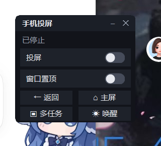

# dsh-phone-mirror

[](https://github.com/xiaozqi/dsh-phone-mirror/actions/workflows/ci.yml)
[](LICENSE)

给 [DSH](https://github.com/deepseek-ai) 加一个「手机投屏」：点一下，桌面上出现一个 **scrcpy 原生窗口**（可选置顶）。

三个入口，同一套接口：

| 入口 | 位置 | 说明 |
| --- | --- | --- |
| **DSH 浮窗** | DSH 页面右下角 | 默认收成一个小胶囊，点开是「投屏 / 置顶 / 桌面窗」三个开关 + 返回/主屏/多任务/唤醒 |
| **桌面控制窗** | 桌面上一个独立小窗口 | 全局置顶、能拖到任何地方、能最小化；和浮窗同一套交互 |
| **设置 → 手机投屏** | DSH 个人头像 → 设置（`Ctrl+,`） | 选设备、起停、改参数 |

> 为什么浮窗不能“拖出 DSH”？网页元素被裁剪在 Electron 窗口里，Windows 上拖不出去。
> 要真正全局，只能是一个独立的操作系统窗口——也就是桌面控制窗。

## 长什么样

| DSH 浮窗 | 桌面控制窗 |
| --- | --- |
|  |  |

设置 → 手机投屏（选设备、起停、各项开关）：


## 设计：一个进程，一个状态机

| 角色 | 谁来做 |
| --- | --- |
| 画面 | **scrcpy 自己的窗口**（就是那个能点的窗口），可选 `--always-on-top` |
| 控制 | 浮窗/桌面窗的按钮 → `adb shell input keyevent`；点窗口 = 直接操作手机（scrcpy 自带） |
| 状态 | `idle → starting → running → stopping → idle`，异常一律落到 `error` |
| 失败 | 进程退出就是失败，没有「进程死了状态还活着」 |

**刻意放弃的东西**：面板里再嵌一份手机画面。那需要在 scrcpy 和浏览器之间架一条视频链
（代理 + ffmpeg + MJPEG），上一版 90% 的崩溃、黑屏、假死都出在那条链上。
取舍和踩过的坑都写在 [LESSONS.md](LESSONS.md)。

## 桌面控制窗

`bin/PhoneMirrorWidget.exe` 是一个 17KB 的 C# WinForms 程序（源码 `tools/widget.cs`），
不是 PowerShell——后台进程就叫 `PhoneMirrorWidget.exe`，内存约 40MB。

它同时是一个 CLI 小工具，宿主在用它做两件事：

```bat
PhoneMirrorWidget.exe --topmost on|off   :: 秒切 scrcpy 窗口置顶，不用重启 scrcpy
PhoneMirrorWidget.exe --getsize          :: 把投屏窗口客户区尺寸写到 %TEMP%\dsh-phone-size.txt
```

重新编译（只有改界面时才需要，Windows 自带 .NET Framework，无需装 SDK）：

```powershell
powershell -ExecutionPolicy Bypass -File tools/build-widget.ps1
```

`tools/widget.ps1` + `tools/widget.vbs` 是 **没有 exe 时的兜底**（PowerShell 版，内存约 117MB）。
正常情况请用 exe。

## 依赖

- Windows（用了 `taskkill`；换平台改 `lib/session.js` 里一处）
- [adb](https://developer.android.com/tools/releases/platform-tools)
- [scrcpy](https://github.com/Genymobile/scrcpy) 2.x / 5.x

两个都在 PATH 里最省事；也可以在设置里填绝对路径。任何开了 adb 调试的 Android 都能投，
换手机 = 在设置里选设备。

## 安装

1. 把本目录放到 `~/.dsh/plugins/dsh-phone-mirror`
2. 在 profile 的 `package.json` 里加：

   ```json
   "dependencies": { "dsh-phone-mirror": "file:C:/Users/<you>/.dsh/plugins/dsh-phone-mirror" },
   "dsh": { "profile": { "bundles": [ "...", "dsh-phone-mirror" ] } }
   ```

3. 重启 DSH

## 配置（`~/.dsh/phone-mirror.json`）

| 键 | 默认 | 说明 |
| --- | --- | --- |
| `serial` | `""` | `ip:5555` 或 USB 序列号 |
| `adb` | `""` | 留空自动找 |
| `scrcpy` | `""` | 留空自动找 |
| `autoStart` | `false` | DSH 起来后自动投屏 |
| `widget` | `true` | DSH 页面加载时自动拉起桌面控制窗 |
| `alwaysOnTop` | `true` | 手机窗口置顶 |
| `windowWidth` | `460` | 窗口内容宽度（物理像素）；拖过窗口大小后会在停止时自动记住 |
| `turnScreenOff` | `true` | 投屏时关手机屏幕（省电，窗口照常显示） |
| `graceMs` | `1200` | scrcpy 活过这么久才算启动成功 |
| `reconnect` | `true` | 意外掉线后每 10 秒重试，最多 6 次 |

## 接口（全部同源可写，跨站写操作一律 403）

| 方法 | 路径 | 作用 |
| --- | --- | --- |
| GET | `/dsh-phone-mirror/status` | 状态机当前状态、错误、设备型号、`widgetRunning` |
| GET/POST | `/dsh-phone-mirror/config` | 读/写配置 |
| GET | `/dsh-phone-mirror/devices` | `adb devices -l` |
| POST | `/dsh-phone-mirror/start` `/stop` | 起停投屏窗口 |
| POST | `/dsh-phone-mirror/key` | `{code}` 发送按键（4 返回 / 3 主屏 / 187 多任务 / 224 唤醒） |
| POST | `/dsh-phone-mirror/topmost` | `{on:true|false}` 切换置顶；有 exe 时**原生秒切**，否则重启窗口 |
| POST | `/dsh-phone-mirror/widget` | 拉起桌面控制窗 |
| POST | `/dsh-phone-mirror/widget/ping` | 控制窗心跳 `{pid}`，宿主据此判断开关状态 |
| POST | `/dsh-phone-mirror/widget/close` | 关掉控制窗（按上次心跳的 PID） |
| GET | `/dsh-phone-mirror/log` | 最后 120 行日志 |

## 常见问题

- **scrcpy 崩溃 `0xC0000005`**：通常是端口/驱动冲突。停掉再来一次，或换 USB / 换 `adb tcpip` 端口。
- **窗口是黑的**：手机息屏或锁屏了。点「☀ 唤醒」，或先手动解锁。
- **点窗口没反应**：确认手机没锁屏；scrcpy 的鼠标输入需要窗口在前台。
- **窗口太大/太小**：设置里的「窗口宽度」是物理像素，125% 缩放时 460 ≈ 368 逻辑像素。也可以直接拖窗口边缘，停止时会记住。
- **掉线了**：默认自动重连（每 10 秒一次，最多 6 次）；也可以在设置里关掉。
- **日志在哪**：`~/.dsh/phone-mirror.log`（会滚动）。在浏览器里打开 `/dsh-phone-mirror/log` 看最后 120 行，
  中文不会乱码；用 Windows PowerShell 直接 `Get-Content` 看需要 `-Encoding UTF8`。

## 测试

```bash
npm test        # 等价于 node --test
```

14 个用例，不依赖手机、不启动 scrcpy：

- **纯函数**：scrcpy 参数拼装、`adb devices -l` / `wm size` 解析、退出码翻译、配置校验
- **宿主冒烟**：用假 `ctx` 跑 `apply()`，确认核心路由都注册上了、`/status` 和 `/config` 返回结构正确、
  跨站写操作会被 403 拦掉

CI 在 GitHub Actions 上跑 Node 20 / 22（ubuntu），推上去就能看到徽章状态。

## License

MIT
