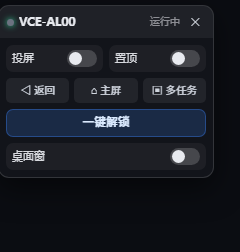

# 手机投屏 · 新手指南

这份指南假设你：有一台 Windows 电脑（装着 DSH）、一部安卓手机、一根数据线，**别的什么都没准备**。
照着做，大约 10 分钟。

---

## 先说清楚三件事

1. **它会做什么**：把手机屏幕放进一个电脑窗口里。用鼠标点窗口，就等于点手机。
2. **不会有人远程接管你的手机**：只有你电脑上这个窗口能操作它，关掉投屏就断。
3. **锁屏密码只存在你自己的电脑上**（明文，写在配置文件里），公共电脑上别用这个功能。

---

## 第 1 步：找到胶囊

打开 DSH，看窗口**顶部正中间**——应该有一个深色小胶囊，写着「● 手机」。

- **有** → 点一下，面板会在同一个位置展开。继续第 2 步。
- **没有** → 说明插件没装，跳到文末「插件还没装」。

---

## 第 2 步：装两个小工具（只需要一次）

如果面板显示「缺少 adb / scrcpy」，说明电脑上还没有这两个工具：

| 工具 | 干什么的 |
| --- | --- |
| **adb** | 电脑和手机之间的「传令兵」 |
| **scrcpy** | 把手机画面搬进窗口的那个程序 |

1. 点「**安装 adb**」，等它跑完（1~3 分钟；可能弹一个「是否允许」的窗口，点**是**）。
2. 再点「**安装 scrcpy**」，同样等它跑完。

装完面板会自己刷新。如果还显示缺，点一下「**重新检测**」。

> 电脑上没有 winget（很老的 Win10 可能没有）时，面板会提示手动安装，下载地址在文末。

---

## 第 3 步：让手机允许电脑调试

这一步**只做一次**。

1. 手机上打开 **设置 → 关于手机**，连续点 **7 次「版本号」**，直到提示「已进入开发者模式」。
2. 回到 **设置 → 系统和更新 → 开发人员选项**（有的手机在「系统」里面），打开 **USB 调试**。
3. 用数据线把手机连到电脑。
4. 手机上会弹「**是否允许 USB 调试？**」——勾上「始终允许」，点**允许**。

> 没弹窗？拔掉线重插一次；或者下拉通知栏，把 USB 用途从「仅充电」改成「传输文件」。

---

## 第 4 步：在面板里选手机

回到 DSH 面板，它应该已经显示：

```
发现 你的手机型号
192.168.137.195:5555
[ 用它 ]
```

点「**用它**」。面板就变成正常的样子了。

如果显示「**手机插着，但还没授权**」：说明第 3 步的最后一下没点，回手机上点「允许」，再点「重新查找」。

---

## 第 5 步：点「投屏」

打开面板上的 **投屏** 开关。

几秒后，电脑上会出现一个手机窗口。**用鼠标点窗口 = 点手机屏幕**，键盘打字也会进手机。

窗口默认在最上面（置顶）。不想它挡着，就关掉 **置顶** 开关——注意这会重启一次窗口，闪一下是正常的。

---

## 面板上每个东西是干嘛的



| 控件 | 作用 |
| --- | --- |
| **投屏** | 开 / 关手机窗口 |
| **置顶** | 手机窗口是不是永远在最前面 |
| **◁ 返回 / ⌂ 主屏 / ▣ 多任务** | 等于按手机下面那三个导航键 |
| **一键解锁** | 解锁或锁屏，见下一节 |
| **✕** | 收成小胶囊 |
| 拖标题条 | 把面板拖到别处；下次打开会回到屏幕上方中间 |
| `Ctrl+Shift+M` | 收起 / 展开面板 |

---

## 解锁和锁屏

- 手机**没设**锁屏密码：点一下「一键解锁」，屏幕亮起就解锁了，不会再问什么。
- 手机**设了**密码：第一次点，面板会让你输入 PIN：

  ```
  手机设了锁屏密码，需要你提供 PIN 才能解锁
  [ 锁屏 PIN（4~12 位数字） ]
  [ 保存并解锁 ]
  ```

  填一次就记住了。它存在电脑上的
  `C:\Users\你的用户名\.dsh\dsh-dfy-mirror.json` 里（明文，注意别泄露）。

- 手机已经解锁时，按钮会变成绿色「**已解锁 · 点一下锁屏**」，点它就锁屏。

---

## 常见问题

| 现象 | 怎么办 |
| --- | --- |
| 面板一直显示「未配置」 | 还没选手机，回到第 4 步 |
| 点投屏说「手机不在线」 | 数据线松了，或手机睡太久断了。重插一次，手机亮屏后再点 |
| 窗口是黑的 | 手机息屏了，点「解锁」 |
| 点了窗口没反应 | 手机在锁屏，先点「解锁」再点窗口 |
| 找不到胶囊 / 面板 | 按 `Ctrl+Shift+M`，或按 F5 刷新页面 |
| 装工具失败 | 手动装（见文末下载地址），装完把路径填进配置文件，或放进 PATH 后重启 DSH |

---

## 进阶：不用数据线（可选）

手机和电脑连同一个 Wi-Fi（或者手机连电脑开的热点），先按前面步骤用 USB 连上，然后在电脑上打开命令行执行：

```
adb tcpip 5555
adb connect 手机IP:5555
```

手机 IP 在 **设置 → WLAN → 当前连接的网络** 里看。之后拔掉线也能投屏。

---

## 插件还没装？

如果 DSH 顶部没有胶囊，说明插件没装。需要：

1. 把插件文件夹放到 `C:\Users\你的用户名\.dsh\plugins\dsh-dfy-mirror`
2. 打开 `C:\Users\你的用户名\.dsh\profiles\desktop\package.json`，在 `dependencies` 里加一行：

   ```json
   "dsh-dfy-mirror": "file:C:/Users/你的用户名/.dsh/plugins/dsh-dfy-mirror"
   ```

3. 在同一个文件的 `dsh.profile.bundles` 数组里加上 `"dsh-dfy-mirror"`
4. 完全退出 DSH，再打开

> 改之前先把 `package.json` 复制一份备份。这一步比前面所有步骤都容易出错，
> 没把握就找装过的人帮忙。

---

## 手动下载地址

- adb（Android Platform Tools）：<https://developer.android.com/tools/releases/platform-tools>
- scrcpy：<https://github.com/Genymobile/scrcpy/releases>

下载后解压，把 `adb.exe` / `scrcpy.exe` 的完整路径填进
`C:\Users\你的用户名\.dsh\dsh-dfy-mirror.json` 的 `adb` / `scrcpy` 两个字段（或者把它们所在目录加进系统 PATH），
然后重启 DSH。
